# 💫 About Me

Hi, I'm Mihdan Advani! I work in IT infrastructure and network security, and I've been building for the web since 2022.

I'm currently a Cybersecurity & Risk Management Jr. Officer. I build and look after security tooling (SIEM, EDR, monitoring, detection and automation), investigate incidents and vulnerabilities, and write security SOPs. Before this role I ran network and server monitoring with Grafana and Zabbix.

Outside work I build web apps with React and Next.js, including the site and web tools for [BFTX Creative](https://bftx.site). I got into machine learning through the Bangkit Academy 2023 ML cohort and still pick up ML side projects now and then.

My portfolio and blog live at **[mihdan.my.id](https://mihdan.my.id)**.

## 🌐 Socials

   
## 🛠️ Recent Projects

| Project | What it does |
| --- | --- |
| [iPhone Link](https://github.com/mihdan15/iphone-link) | Shows and controls an iPhone from a Windows laptop: AirPlay for the screen, Bluetooth for keyboard and mouse. No jailbreak and nothing to install on the phone. Open source (GPL-3.0). |
| [wazuh-telegram-soc](https://mihdan.my.id/project/wazuh-telegram-soc) | Routes Wazuh alerts into a Telegram group with one topic per category. Important alerts go out in real time with dedup, and noisy categories arrive as periodic digests. |
| [eset-mcp](https://mihdan.my.id/project/eset-mcp-read-only) | A read-only MCP server that lets Claude answer questions about ESET PROTECT Cloud: devices, detections, incidents, vulnerabilities and patches. |
| [bionic-backports-for-php74](https://github.com/mihdan15/bionic-backports-for-php74) | Unofficial rebuilds of Sury's PHP 7.4 packages for Ubuntu 18.04, carrying the backported fixes for CVE-2026-109618 and CVE-2026-109619. |
| [bftx.site](https://mihdan.my.id/project/bftx-site) | The BFTX Creative website plus web tools on its subdomains, including a PDF workbench with 254 tools, a background remover and media downloaders. |
| [mihdan.my.id](https://mihdan.my.id/project/portofolio-mihdan-my-id) | My portfolio and blog: Next.js 16 and Hygraph on Cloudflare Workers via OpenNext, in Indonesian and English. |

## 🧰 Tech Stack

| Area | Tools |
| --- | --- |
| Security & infrastructure |  plus Wazuh, Zabbix and ESET PROTECT |
| Web |  |
| Data & ML |  |

## 📊 GitHub Stats

  
  

---

